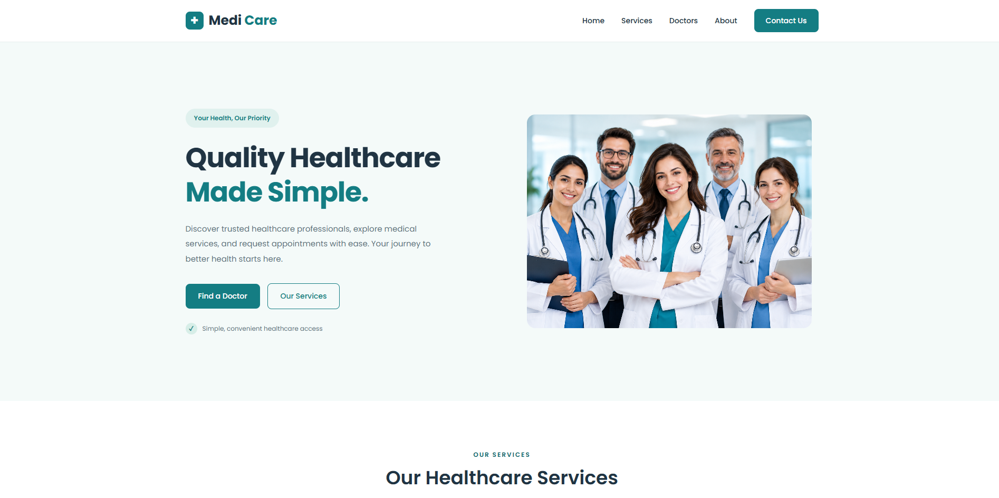
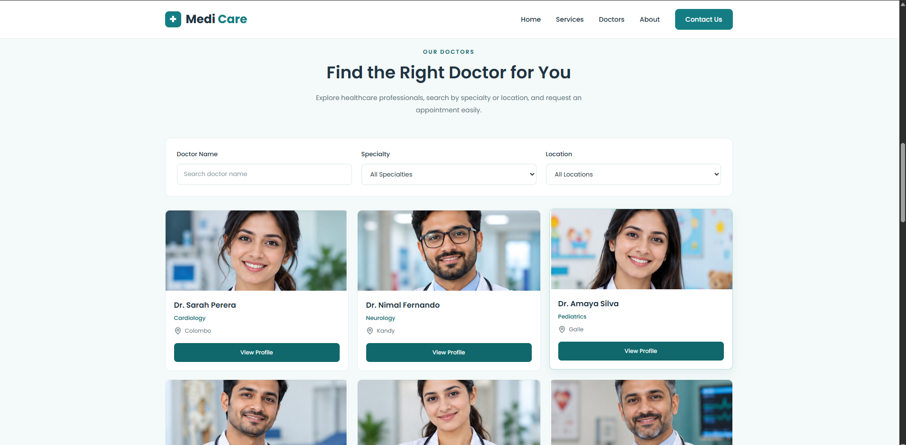
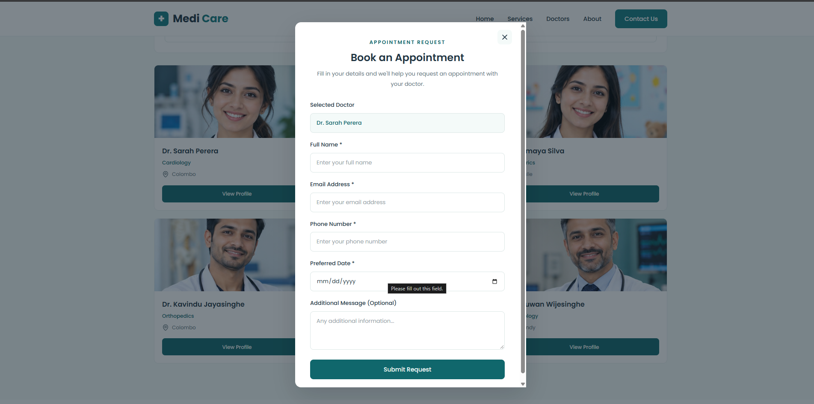
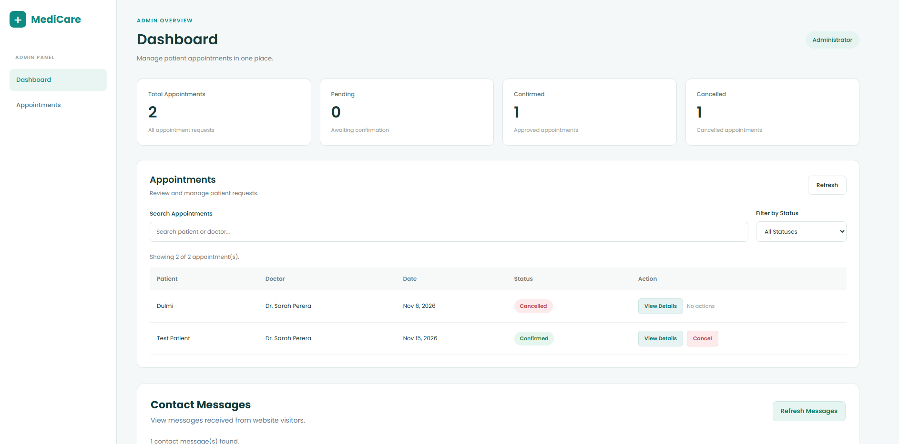
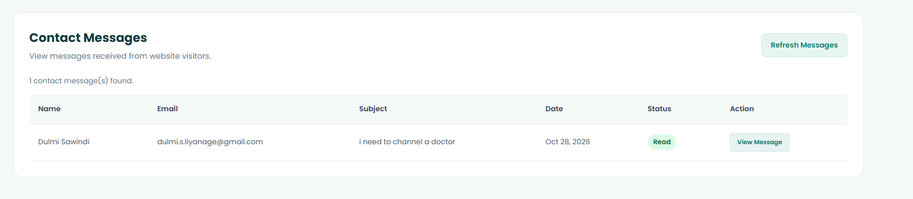

# MediCare — Healthcare Appointment Booking System

MediCare is a full-stack healthcare website that allows patients to explore medical services, browse doctors, request appointments, and contact the healthcare team.

The project also includes a secure admin dashboard for managing appointment requests and contact messages.

## Tech Stack

### Frontend
- HTML5
- CSS3
- JavaScript
- Lucide Icons

### Backend
- Node.js
- Express.js

### Database
- MongoDB Atlas
- Mongoose

### Authentication
- JSON Web Tokens (JWT)
- bcrypt

## Key Features

### Patient Website
- Responsive healthcare website
- Medical services section
- Doctor listings with search and filters
- Doctor profile modal
- Appointment request form
- Contact Us form with MongoDB integration

### Admin Dashboard
- Admin login with JWT authentication
- Appointment management
- Appointment status updates
- Appointment search and filtering
- Appointment statistics
- Contact message management
- Automatic unread-to-read message status updates

## Project Structure

MediCare/
├── client/
│   ├── admin/
│   ├── assets/
│   ├── css/
│   ├── js/
│   └── index.html
├── server/
│   ├── middleware/
│   ├── models/
│   ├── routes/
│   ├── scripts/
│   └── server.js
└── README.md


## Getting Started

### Prerequisites

Make sure you have installed:

- Node.js and npm
- Git
- A code editor such as VS Code
- A MongoDB Atlas database

### 1. Clone the Repository

```bash
git clone https://github.com/YOUR-USERNAME/MediCare.git
cd MediCare
```

Replace `YOUR-USERNAME` with your GitHub username.

### 2. Install Backend Dependencies

```bash
cd server
npm install
```

### 3. Configure Environment Variables

Create a `.env` file inside the `server` folder.

```env
PORT=5000
MONGODB_URI=your_mongodb_connection_string
JWT_SECRET=your_secure_jwt_secret
```

Use the exact environment variable names expected by `server.js` and the authentication code.

Never commit your `.env` file to GitHub.

### 4. Start the Backend

```bash
npm run dev
```

The backend should start on:

http://localhost:5000

### 5. Start the Frontend

Open `client/index.html` using Live Server in VS Code or Antigravity IDE.

### 6. Access the Admin Dashboard

Open:

`client/admin/login.html`

Sign in using an admin account configured locally.

Admin accounts are created through the backend setup process and are not included in the repository.

## API Endpoints

| Method | Endpoint | Description |
|---|---|---|
| POST | `/api/appointments` | Submit an appointment request |
| GET | `/api/appointments` | Retrieve appointments (admin) |
| PATCH | `/api/appointments/:id/status` | Update appointment status (admin) |
| POST | `/api/contact` | Submit a contact message |
| GET | `/api/contact` | Retrieve contact messages (admin) |
| PATCH | `/api/contact/:id/read` | Mark a message as read (admin) |

Protected endpoints require an admin JWT.

## Security

- Passwords are hashed using bcrypt.
- Admin authentication uses JWT.
- Protected API routes require authentication.
- Environment variables are excluded from Git.
- Form submissions are validated on the backend.


## Project Screenshots

### Homepage


### Doctors Section


### Appointment Booking


### Admin Dashboard


### Contact Messages



## Project Status

Core functionality completed. Deployment preparation in progress.

## Author

Developed as a full-stack web development portfolio project.
